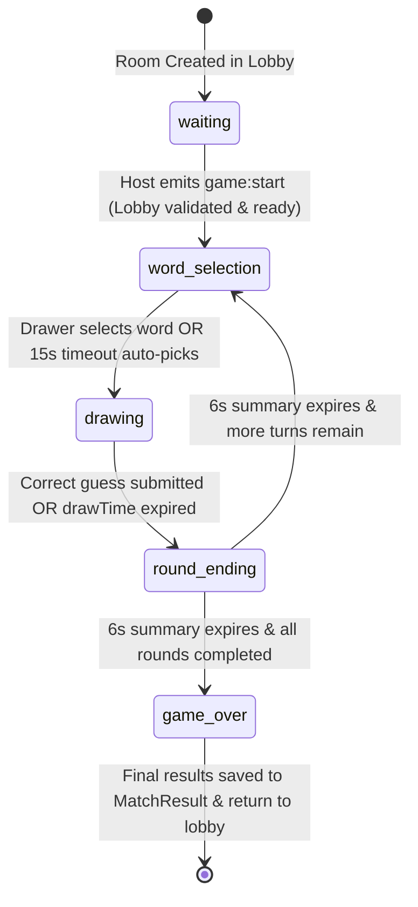

# DrawMate Game Engine Architecture (Phase 4)

## 1. System Overview

The DrawMate Game Engine is a fully server-authoritative, real-time multiplayer system coordinating game sessions, secret word selection, turn rotation, drawing authorization, timers, live guess evaluation, scoring, progressive hints, and final match persistence.

It directly integrates with:
- **Phase 1 Foundations:** Authenticated user identities, unique usernames, avatars, and profile preferences.
- **Phase 2 Multiplayer Infrastructure:** Room lifecycle, player readiness verification, host permissions, and Socket.IO presence rooms (`room:${roomCode}`).
- **Phase 3 Drawing Engine:** `DrawingSessionManager`, granting exclusive canvas drawing rights to the active drawer and synchronizing stroke operations.

---

## 2. Core Architectural Components

### 2.1 GameManager (`server/src/game/GameManager.ts`)
- **Pattern:** Process-wide Singleton.
- **Role:** High-level registry managing all active `Game` instances indexed by normalized `roomCode`.
- **Responsibilities:**
  - Instantiates new games when host start requests are validated (`startGame`).
  - Routes player actions (`game:word_select`, `game:guess`, `game:get_state`) to the designated room's `Game` instance.
  - Cleans up active game sessions when rooms are closed or cancelled (`removeGame`).

### 2.2 Game (`server/src/game/Game.ts`)
- **Role:** Encapsulates the complete authoritative state, rules, timers, and lifecycle of a single active match.
- **Responsibilities:**
  - Owns the game state machine (`waiting`, `word_selection`, `drawing`, `round_ending`, `game_over`, `cancelled`).
  - Controls round and turn advancement across configured rounds (`totalRounds`).
  - Coordinates drawer assignment and deterministic rotation.
  - Generates viewer-specific sanitized snapshots (`getViewerSnapshot`) ensuring secret words and unselected choices are never leaked to guessers.
  - Coordinates with `DrawingSessionManager` to set the drawer and clear the canvas upon new turns.
  - Evaluates guesses, updates player score tables, and triggers idempotent round completion.
  - Persists completed game results to MongoDB upon `game_over`.

### 2.3 WordService (`server/src/game/WordService.ts`)
- **Word Bank:** Structured dictionary (`words.data.ts`) categorized across `animals`, `food`, `objects`, `nature`, `sports`, `technology`, and `general` with difficulty classifications.
- **Functions:**
  - `getWordChoices(category, count, excludeWords)`: Provides random distinct candidate words matching room settings.
  - `normalizeGuess(text)`: Normalizes input by trimming leading/trailing whitespace, converting to lowercase, stripping diacritics/accents, and collapsing repeated spaces.
  - `isMatch(guess, secretWord)`: Authoritatively compares normalized strings for exact identity.
  - `generateMask(word, revealedIndices)`: Generates masked blanks (`_ _ _ _`) while preserving spaces and safe punctuation.

### 2.4 ScoringService (`server/src/game/ScoringService.ts`)
- **Formula:**
  $$\text{Guesser Score} = \text{Base Points (100)} + \left( \frac{\text{Time Remaining}}{\text{Total Draw Time}} \times \text{Speed Bonus (100)} \right)$$
- **Drawer Bonus:** Flat 50 points awarded to the active drawer when at least one player successfully guesses the secret word.
- **Rules:**
  - Incorrect guesses award 0 points.
  - A player who has already guessed correctly cannot score additional points in the same round.
  - Time remaining is derived from authoritative server timestamps, not client clocks.

### 2.5 HintService (`server/src/game/HintService.ts`)
- **Schedule:** Computes hint reveal offsets in milliseconds evenly distributed across turn duration:
  $$\text{Offset}_i = \text{Draw Time} \times \left( \frac{i}{\text{Hint Count} + 1} \right)$$
- **Reveals:** Progressively picks eligible unrevealed letter indices without disclosing the complete secret word.
- **Disabling:** When room settings configure `hints: 0`, the offset schedule is empty and no hints are revealed.

---

## 3. Authoritative State Machine & Lifecycle

### Valid Lifecycle Phases:
1. `waiting`: Room is in lobby mode. Players join, configure avatars, and toggle ready state.
2. `word_selection`: Host requested start. Server designated drawer and generated 3 word choices. 15-second selection deadline active.
3. `drawing`: Word selected. Active drawer can draw; guessers submit guesses via chat. Hints and deadlines tick authoritatively.
4. `round_ending`: Turn concluded (via correct guess or timeout). Server reveals the word, distributes points, and broadcasts round summary for 6 seconds.
5. `game_over`: All configured rounds completed. Server calculates rankings, handles ties, persists `MatchResult` in MongoDB, and presents final podium.
6. `cancelled`: Game aborted due to room termination or insufficient connected players.

---

## 4. Secret Word Security & Role-Specific Snapshots

To prevent Skribbl-style cheat extensions from scraping secret words from DOM or network payloads:
1. **Never Broadcast Canonical Secret:** The server never emits raw secret words to observers during the active drawing phase.
2. **Viewer-Specific Serialization:** `Game.getViewerSnapshot(viewerUserId)` serializes role-specific payloads:
   - **For Active Drawer:** Receives `word.choices` during selection, and `word.secret` during drawing.
   - **For Guessers / Observers:** Receives `word.masked` (`_ _ _ _`), `word.revealedIndices`, `word.length`, and `category`. `word.secret` and `word.choices` are strictly `undefined`.
   - **Post-Round:** During `round_ending` and `game_over`, `word.secret` is safely revealed to all players.
3. **Private User Sockets:** Each authenticated socket automatically joins a private user channel (`user.userId`) on connection, ensuring private snapshots are delivered exclusively to authorized recipients.

---

## 5. Turn Rotation Policy

1. **Initial Drawer:** The first player in the room's participant order at the time of game start.
2. **Deterministic Sequence:** Rotates in order through all eligible players (`turnIndex` advances from 0 to $N-1$).
3. **Round Advance:** When all players have taken one turn as the drawer, `turnIndex` resets to 0 and `currentRound` increments.
4. **Game Conclusion:** When `currentRound > totalRounds`, the game transitions directly to `game_over`.

---

## 6. Real-Time Drawing Integration

When transitioning into the `drawing` phase:
1. `Game` notifies `DrawingSessionManager.getInstance().setDrawer(roomCode, currentDrawerId)`.
2. Old canvas strokes from previous turns are cleared via `DrawingSessionManager.getInstance().clear(roomCode, currentDrawerId)`.
3. Socket event `draw:canvas_cleared` is emitted to all room participants.
4. Only the active drawer can emit `draw:stroke_start`, `draw:stroke_points`, `draw:undo`, and `draw:clear`. Unauthorized guesser drawing requests are rejected with 403-equivalent socket errors.
5. When the turn ends (`round_ending`), drawer privileges are revoked (`setDrawer(roomCode, '')`).

---

## 7. Match Persistence Model (`MatchResult`)

Upon game conclusion, completed match statistics are idempotently saved to MongoDB:
- **Game ID:** Unique game session identifier.
- **Room Code:** Associated room code.
- **Rounds Played:** Total match rounds.
- **Category:** Word bank category used.
- **Players:** Array of participant scores, final rankings, correct guesses count, and drawing turns completed.
- **Winner:** Winner user ID, display name, and final score (shared winner name for ties).
- **Timestamps:** Started and completed timestamps.
- **Status:** `'completed' | 'cancelled'`.
